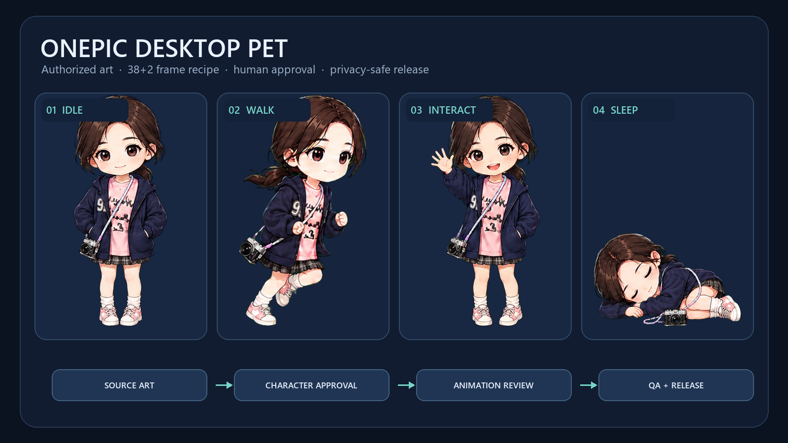

# OnePic Desktop Pet Framework

[简体中文](README.md) · [Contributing](CONTRIBUTING.md) · [Security](SECURITY.md)

[](https://github.com/zifanersuotang/OnePic-Desktop-Pet-Framework/actions/workflows/ci.yml)
[](https://www.python.org/)
[](https://www.microsoft.com/windows/)
[](LICENSE)
[](ASSETS_LICENSE.md)

Turn one **authorized character image** into a Windows desktop pet through explicit character approval, animation review, automated tests, and release evidence.



> Code is MIT-licensed. Bundled demo character art is CC BY-NC 4.0 and is not licensed for commercial use.

## Highlights

- A 38-frame base Sprite recipe, with two optional head-pat transition frames for the 40-frame upgraded profile.
- Hash-bound human approval gates for the character and walk cycle, or an approved substitute interaction.
- Private source art, customer assets, drafts, and build history stay under the Git-ignored `user_assets/` tree.
- Tests, runtime smoke evidence, build identity, package manifests, and SHA-256 checks are connected by a fail-closed release workflow.
- JSON-driven animations, behavior, break reminders, and opt-in companion features.

Windows/PySide6 Sprite is the primary supported route. The repository contains research source for a Live2D adapter, but it does **not** redistribute Cubism Core, a prebuilt web bundle, or models. The Android directory is experimental source only.

## Quick start

Requirements: Windows 10/11, Python 3.12, and Git.

```powershell
git clone https://github.com/zifanersuotang/OnePic-Desktop-Pet-Framework.git
cd OnePic-Desktop-Pet-Framework
powershell -ExecutionPolicy Bypass -File .\scripts\setup_environment.ps1
powershell -ExecutionPolicy Bypass -File .\scripts\run.ps1
```

Validate the source checkout:

```powershell
powershell -ExecutionPolicy Bypass -File .\scripts\test.ps1
$env:QT_QPA_PLATFORM = "offscreen"
.\.venv\Scripts\python.exe .\main.py --smoke-test-ms 1500
```

The setup script only creates the local `.venv`; it does not install system software, change system environment variables, or request administrator access.

## Build a private pet

Create an isolated workspace before adding any source art:

```powershell
powershell -ExecutionPolicy Bypass -File .\scripts\new_pet.ps1 -PetId my-pet
```

Register authorized art under `user_assets/pets/my-pet/`, approve one canonical character, review each animation batch, and use:

```powershell
.\.venv\Scripts\python.exe .\tools\pet_workspace.py agent-status my-pet
```

Follow one reported next action at a time. A release is only ready after automated checks and visual review of the actual runtime window.

## Scope

| Route | Repository status | Published by default |
|---|---|---|
| PySide6 Sprite pet | Complete source and demo assets | Yes |
| Break reminders, companion features, extensions | Source included, disabled by default | Explicit opt-in only |
| Android | Experimental source | No |
| Live2D | Adapter/build research source only | No; separate licenses and runtime required |

Automated tests do not replace visual approval of proportions, limbs, keyframes, cursor/UI alignment, or the final window.

## Privacy and security

- `user_assets/**`, virtual environments, build outputs, and local logs are ignored.
- Never attach customer originals, personal photos, secrets, chat logs, or absolute local paths to Issues or pull requests.
- Network companion features are off by default; secrets do not belong in repository files.
- Run the framework check, full test suite, and privacy scan before publishing.

See [Privacy](docs/隐私说明.md), [Security](SECURITY.md), and the [release checklist](docs/发布清单.md).

## Contributing

Bug fixes, tests, documentation, and reusable tools are welcome. Art contributions must include author, source, permitted uses, and verifiable license evidence. Read [CONTRIBUTING.md](CONTRIBUTING.md) first.

## Licenses

- Original code and project documentation: [MIT](LICENSE)
- Bundled demo character art, sprite sheets, and icon: [CC BY-NC 4.0](ASSETS_LICENSE.md)
- Third-party components: [THIRD_PARTY_NOTICES.md](THIRD_PARTY_NOTICES.md)

The former public snapshot remains available at [OnePic-Desktop-Pet](https://github.com/zifanersuotang/OnePic-Desktop-Pet). This repository is the privacy- and license-separated framework mainline.
